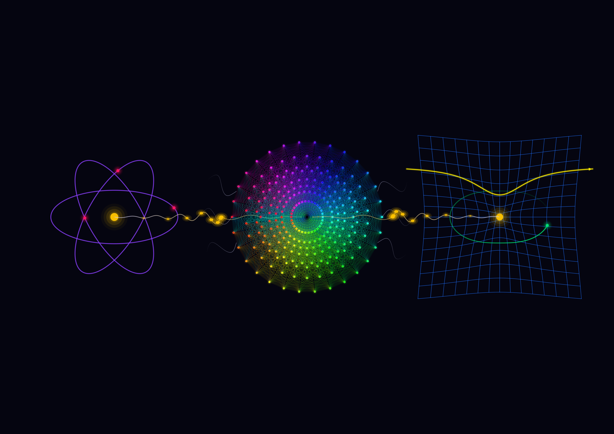
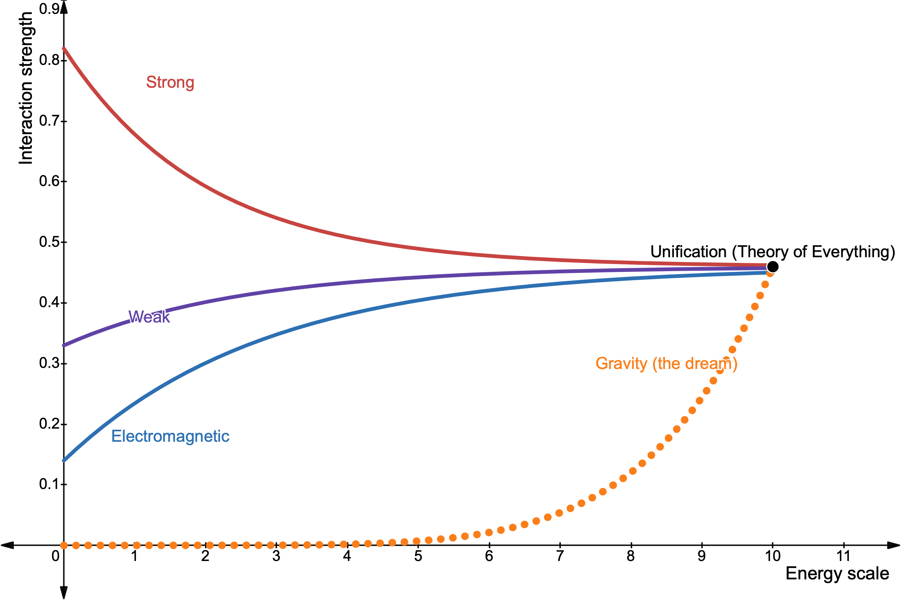

# E8 Artwork — String Theory

## *La beleco savos la mondon*

Œuvre art-science exposée à l'**ISAP 2026, 13ᵉ Heidelberg Laureate Forum** :
👉 [demian-goos.de/isap-2026-13th-hlf/artworks/sophia-mai](https://demian-goos.de/isap-2026-13th-hlf/artworks/sophia-mai/)



*La beleco savos la mondon* signifie « La beauté sauvera le monde » en
espéranto : la phrase de Dostoïevski prêtée au prince Mychkine dans
*L'Idiot*.

L'image montre E8 comme le **pont rêvé** entre les deux grandes théories de
la physique, sans aucun texte hormis le titre :

- **À gauche, la mécanique quantique** : l'atome, son noyau et ses orbites.
- **Au centre, E8** : les 240 racines de E8 projetées sur le plan de
  Coxeter.
- **À droite, la relativité générale** : la grille d'espace-temps courbée
  par une masse, une planète en orbite et un rayon de lumière dévié
  (lentille gravitationnelle).

Un fil vibrant, comme une corde de guitare fixée aux deux bouts, traverse
E8 et relie les deux mondes.

## The change from a fragmented, divided understanding of the universe toward its dreamed unification



Les forces forte, faible et électromagnétique se rapprochent quand
l'énergie augmente. La gravité, elle, ne rejoint les autres que dans le
rêve d'une théorie unifiée.

## Le sens physique

La mécanique quantique et la relativité générale décrivent chacune leur
domaine avec un succès expérimental extraordinaire, mais restent
incompatibles à très petite échelle, là où la gravité devrait elle-même
devenir quantique. Les concilier est le plus grand problème ouvert de la
physique théorique.

La **théorie des cordes hétérotique** est l'une des pistes : les particules
y deviennent des cordes vibrantes, et l'un des modes de vibration est
toujours le **graviton**. Sa cohérence mathématique impose aux 16
dimensions internes la symétrie **E8 × E8** (ou SO(32) dans l'autre
variante). E8, le plus grand groupe de Lie exceptionnel simple, apparaît
ainsi au cœur de l'une des tentatives les plus ambitieuses d'unification.

**Une quête, pas un fait établi.** Aucune prédiction de la théorie des
cordes n'a encore été confirmée par l'expérience. Le titre, emprunté à
Dostoïevski, est un vœu esthétique, pas une thèse scientifique.

> *Reconciling quantum mechanics and general relativity is physics'
> greatest unsolved problem. Heterotic string theory (E8 × E8) is one
> dreamed path toward unification — mathematically beautiful, but not yet
> confirmed by experiment.*

## Structure du projet

```
e8-artwork-string-theory/
├── la_beleco_savos_la_mondon.py   # l'œuvre finale
├── requirements.txt               # dépendances Python (numpy, matplotlib)
└── output/                        # l'œuvre (PNG, SVG) et le diagramme
```

## Utilisation

```bash
pip install -r requirements.txt
python3 la_beleco_savos_la_mondon.py
```

## Exactitude mathématique

Les 240 racines sont construites par leur définition exacte : 112 racines
±eᵢ ± eⱼ et 128 racines (±½)⁸ avec un nombre pair de signes moins. Le code
vérifie à chaque lancement, par `assert`, qu'il y a exactement 240 racines
en dimension 8, toutes de norme² = 2.
